# Tanh Triad

## Documentation navigation

- [README](../README.md)
- Families
  - [Bézier](bezier.md) · [Cassini](cassini.md) · [Circle](circle.md) · [Cosine Quintic](cosine_quintic.md) · [Cusp](cusp.md) · [Ellipse](ellipse.md) · [Epitrochoid](epitrochoid.md)
  - [Fourier](fourier.md) · [Hypotrochoid](hypotrochoid.md) · [Lobed](lobed.md) · [Logarithmic spiral](logarithmic_spiral.md) · [Logistic Dwell](logistic_dwell.md) · [Pascal](pascal.md) · [Superformula](superformula.md) · [Tanh Triad](tanh_triad.md) · [Temple Fay](temple_fay.md)
- Shared
  - [Examples catalogue](../examples/README.md) · [Test layout](../tests/README.md)
  - [Tooth construction](tooth-construction.md) · [Tooth placement](tooth-placement.md) · [Mate motion](mate-motion.md) · [Mate preparation](mate-preparation.md) · [Mate generation](mate-generation.md) · [Pair assembly](pair-assembly.md)
  - [Harmonic common](harmonic-common.md) · [Trochoid common](trochoid-common.md) · [Saturating common](saturating-common.md)

## Module `Tanh Triad`

The unit law is `r(theta)=1+0.13*tanh(1.8*sin(3 theta))+0.03*cos(6 theta+20 degrees)`;
the shared arc-length pitch scaler supplies the requested mean module.
Reference: https://en.wikipedia.org/wiki/Hyperbolic_function.

### Brief content:

**Functions**:

> [`curve_gear_tanh_triad`](#function-curve_gear_tanh_triad): Build a bounded tanh-modulated three-cycle gear.

> [`curve_gear_tanh_triad_2d`](#function-curve_gear_tanh_triad_2d): Build the tanh-modulated 2D gear outline.

> [`curve_gear_tanh_triad_body`](#function-curve_gear_tanh_triad_body): Build the tanh-modulated gear body.

> [`curve_gear_tanh_triad_body_2d`](#function-curve_gear_tanh_triad_body_2d): Build the tanh-modulated 2D body outline.

> [`curve_gear_tanh_triad_centre_distance`](#function-curve_gear_tanh_triad_centre_distance): Return the solved centre distance for a Tanh Triad pair.

> [`curve_gear_tanh_triad_mate`](#function-curve_gear_tanh_triad_mate): Build a Tanh Triad mating gear.

> [`curve_gear_tanh_triad_mate_rotation`](#function-curve_gear_tanh_triad_mate_rotation): Return the mate rotation at a requested Tanh Triad driver phase.

> [`curve_gear_tanh_triad_pair`](#function-curve_gear_tanh_triad_pair): Build a Tanh Triad gear pair.

> [`_cg_tanh_triad_parameters_valid`](#function-_cg_tanh_triad_parameters_valid): Check the shared curve-parameter contract for every family entry point.

> [`_cg_tanh_triad_shape`](#function-_cg_tanh_triad_shape): Bind the named curve once for driver, mate and numeric consumers.

> [`_cg_tanh_triad_unit_radius`](#function-_cg_tanh_triad_unit_radius): Evaluate the stable bounded Tanh Triad radius law.

## Functions

The module `Tanh Triad` defines the following functions.

### Function `curve_gear_tanh_triad`

| Tanh Triad gear 1 | Tanh Triad gear 2 |
| --- | --- |
| [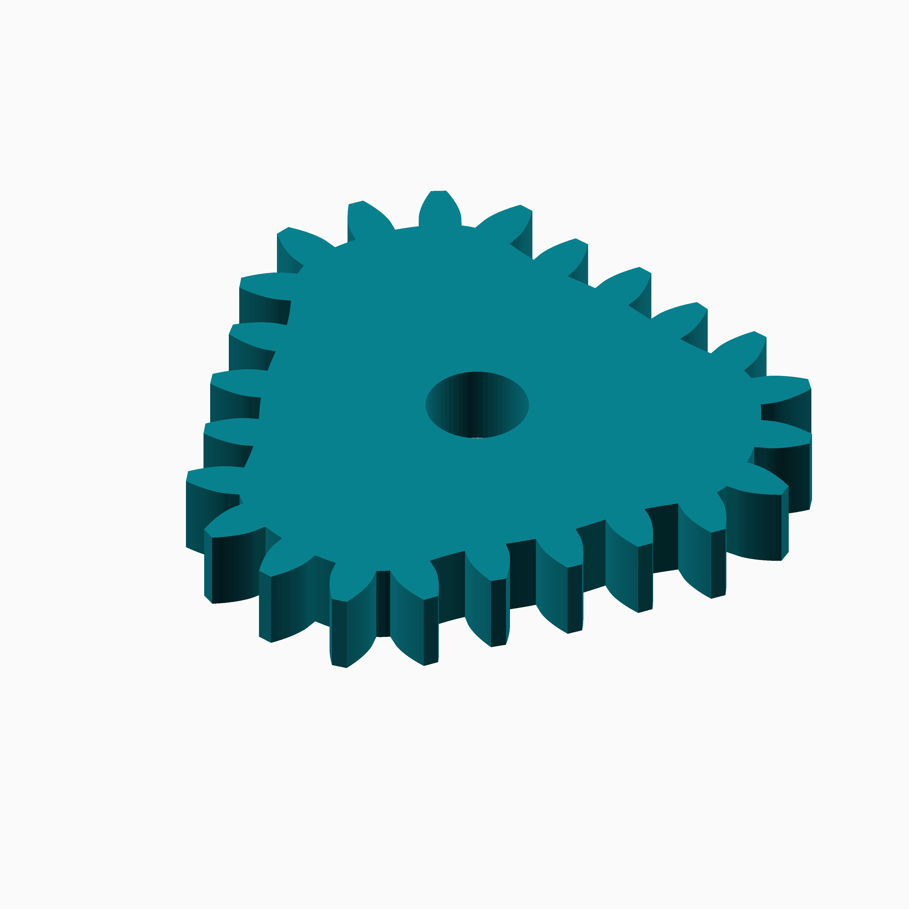](../images/functions/tanh_triad/curve_gear_tanh_triad.png) | [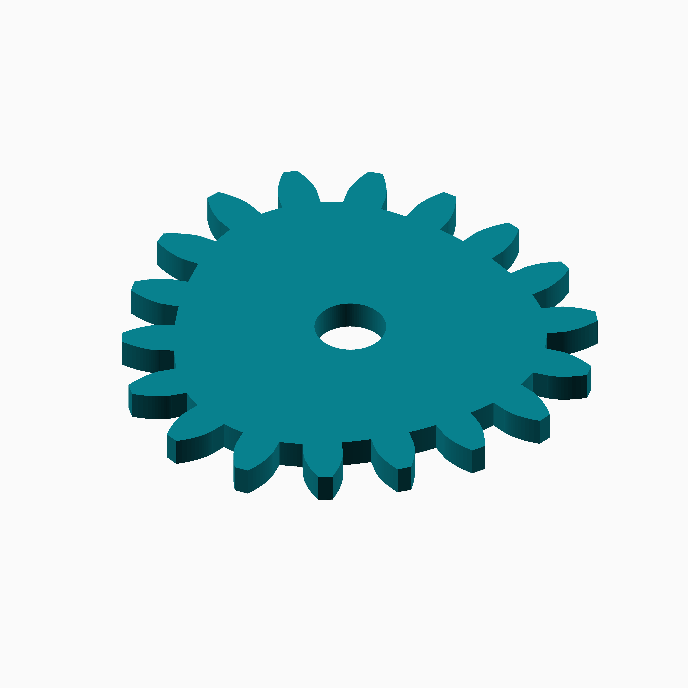](../images/functions/tanh_triad/curve_gear_tanh_triad_alternative.png) |

**Parameters:**

- `modul`: {number > 0} Tooth module in mm.
- `tooth_number`: {integer >= 3} Number of teeth.
- `width`: {number > 0} Extrusion width in mm.
- `bore`: {number >= 0} Centre bore diameter in mm.
- `transition`: {number > 0, default 1.8} Transition steepness.
- `crest`: {0 < number < 0.5, default .13} Main radial modulation.
- `correction`: {0 <= number < 0.2, default .03} Sixth-harmonic correction.
- `pressure_angle`: {angle, default 20} Pressure angle.
- `tooth_phase`: {angle, default 0} Tooth phase.
- `backlash`: {undef or >= 0, default undef} Backlash.
- `clearance`: {undef or >= 0, default undef} Clearance.
- `samples`: {integer >= 120, default 720} Samples.
- `orientation`: {angle, default 0} Orientation.

**Returns:**

No return

Back to [module description](#module-tanh-triad).

### Function `curve_gear_tanh_triad_2d`

| Tanh Triad 2D gear 1 | Tanh Triad 2D gear 2 |
| --- | --- |
| [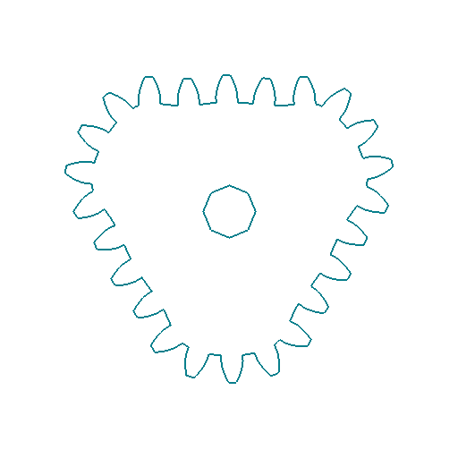](../images/functions/tanh_triad/curve_gear_tanh_triad_2d.png) | [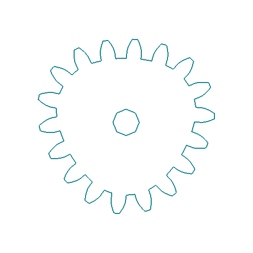](../images/functions/tanh_triad/curve_gear_tanh_triad_alternative_2d.png) |

**Parameters:**

- `modul`: {number} Tooth module.
- `tooth_number`: {integer} Tooth count.
- `bore`: {number} Bore.
- `transition`: {number, default 1.8} Transition.
- `crest`: {number, default .13} Crest.
- `correction`: {number, default .03} Correction.
- `pressure_angle`: {number, default 20} Pressure angle.
- `tooth_phase`: {number, default 0} Tooth phase.
- `backlash`: {number, default undef} Backlash.
- `clearance`: {number, default undef} Clearance.
- `samples`: {integer, default 720} Samples.
- `orientation`: {number, default 0} Orientation.

**Returns:**

No return

Back to [module description](#module-tanh-triad).

### Function `curve_gear_tanh_triad_body`

| Tanh Triad body 1 | Tanh Triad body 2 |
| --- | --- |
| [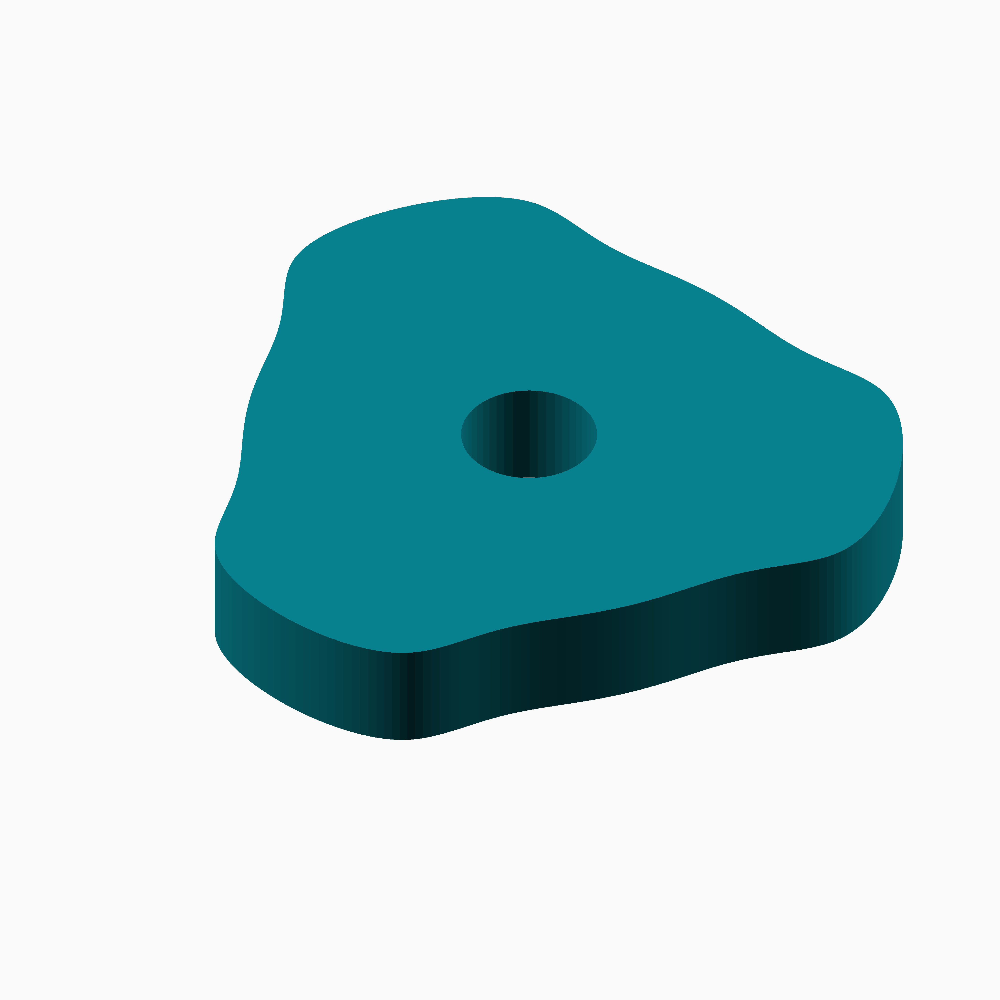](../images/functions/tanh_triad/curve_gear_tanh_triad_body.png) | [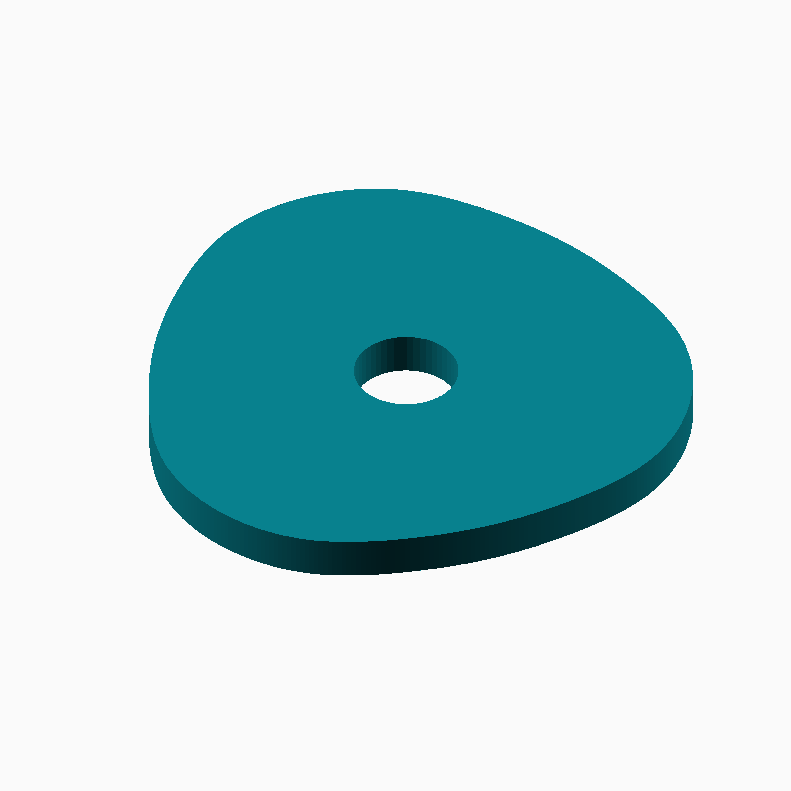](../images/functions/tanh_triad/curve_gear_tanh_triad_body_alternative.png) |

**Parameters:**

- `modul`: {number} Tooth module.
- `tooth_number`: {integer} Tooth count.
- `width`: {number} Width.
- `bore`: {number} Bore.
- `transition`: {number, default 1.8} Transition.
- `crest`: {number, default .13} Crest.
- `correction`: {number, default .03} Correction.
- `pressure_angle`: {number, default 20} Pressure angle.
- `tooth_phase`: {number, default 0} Tooth phase.
- `backlash`: {number, default undef} Backlash.
- `clearance`: {number, default undef} Clearance.
- `samples`: {integer, default 720} Samples.
- `orientation`: {number, default 0} Orientation.

**Returns:**

No return

Back to [module description](#module-tanh-triad).

### Function `curve_gear_tanh_triad_body_2d`

| Tanh Triad 2D body 1 | Tanh Triad 2D body 2 |
| --- | --- |
| [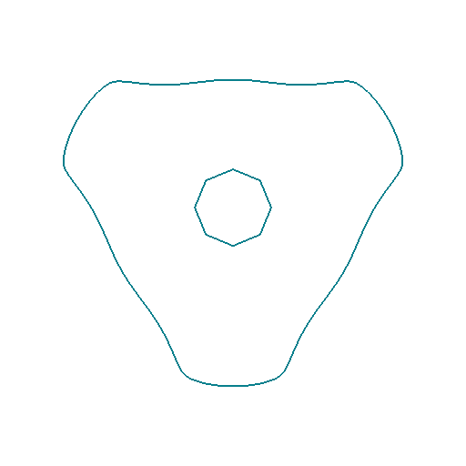](../images/functions/tanh_triad/curve_gear_tanh_triad_body_2d.png) | [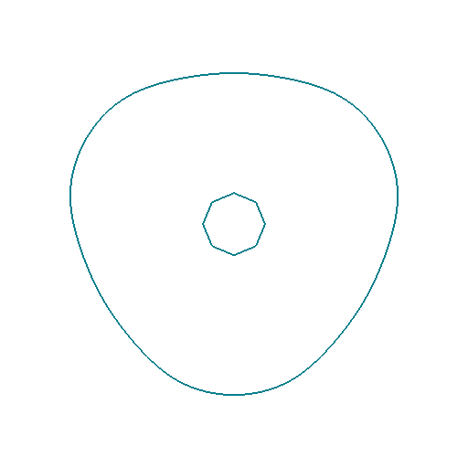](../images/functions/tanh_triad/curve_gear_tanh_triad_body_alternative_2d.png) |

**Parameters:**

- `modul`: {number} Tooth module.
- `tooth_number`: {integer} Tooth count.
- `bore`: {number} Bore.
- `transition`: {number, default 1.8} Transition.
- `crest`: {number, default .13} Crest.
- `correction`: {number, default .03} Correction.
- `pressure_angle`: {number, default 20} Pressure angle.
- `tooth_phase`: {number, default 0} Tooth phase.
- `backlash`: {number, default undef} Backlash.
- `clearance`: {number, default undef} Clearance.
- `samples`: {integer, default 720} Samples.
- `orientation`: {number, default 0} Orientation.
- `body_offset`: {number, default 0} Body offset.

**Returns:**

No return

Back to [module description](#module-tanh-triad).

### Function `curve_gear_tanh_triad_centre_distance`

Return the solved centre distance for a Tanh Triad pair.

**Parameters:**

- `modul`: {number} Tooth module.
- `tooth_number`: {integer} Tooth count.
- `transition`: {number, default 1.8} Transition.
- `crest`: {number, default .13} Crest.
- `correction`: {number, default .03} Correction.
- `samples`: {integer, default 720} Samples.

**Returns:**

- `{number}`: Fixed centre distance in millimetres.

Back to [module description](#module-tanh-triad).

### Function `curve_gear_tanh_triad_mate`

| Tanh Triad mate 1 | Tanh Triad mate 2 |
| --- | --- |
| [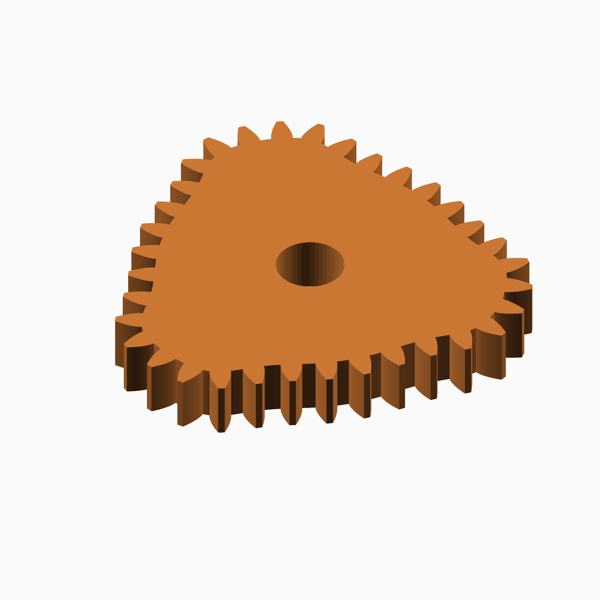](../images/functions/tanh_triad/curve_gear_tanh_triad_mate.png) | [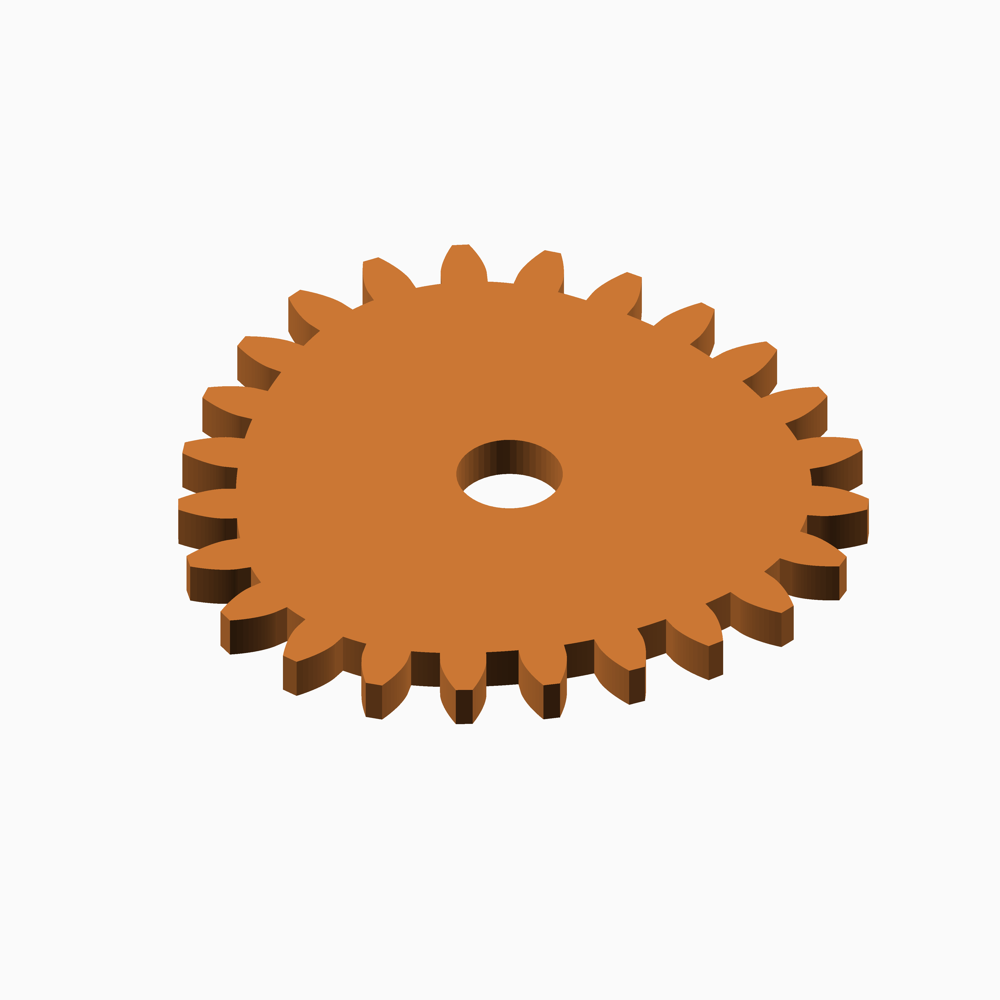](../images/functions/tanh_triad/curve_gear_tanh_triad_mate_alternative.png) |

**Parameters:**

- `modul`: {number} Tooth module.
- `tooth_number`: {integer} Tooth count.
- `width`: {number} Width.
- `bore`: {number} Bore.
- `transition`: {number, default 1.8} Transition.
- `crest`: {number, default .13} Crest.
- `correction`: {number, default .03} Correction.
- `pressure_angle`: {number, default 20} Pressure angle.
- `tooth_phase`: {number, default 0} Tooth phase.
- `backlash`: {number, default undef} Backlash.
- `clearance`: {number, default undef} Clearance.
- `samples`: {integer, default 720} Samples.

**Returns:**

No return

Back to [module description](#module-tanh-triad).

### Function `curve_gear_tanh_triad_mate_rotation`

Return the mate rotation at a requested Tanh Triad driver phase.

**Parameters:**

- `modul`: {number} Tooth module.
- `tooth_number`: {integer} Tooth count.
- `transition`: {number, default 1.8} Transition.
- `crest`: {number, default .13} Crest.
- `correction`: {number, default .03} Correction.
- `samples`: {integer, default 720} Samples.
- `phase`: {number, default 0} Driver phase.

**Returns:**

- `{angle}`: Mate display rotation in degrees.

Back to [module description](#module-tanh-triad).

### Function `curve_gear_tanh_triad_pair`

| Tanh Triad pair 1 | Tanh Triad pair 2 |
| --- | --- |
| [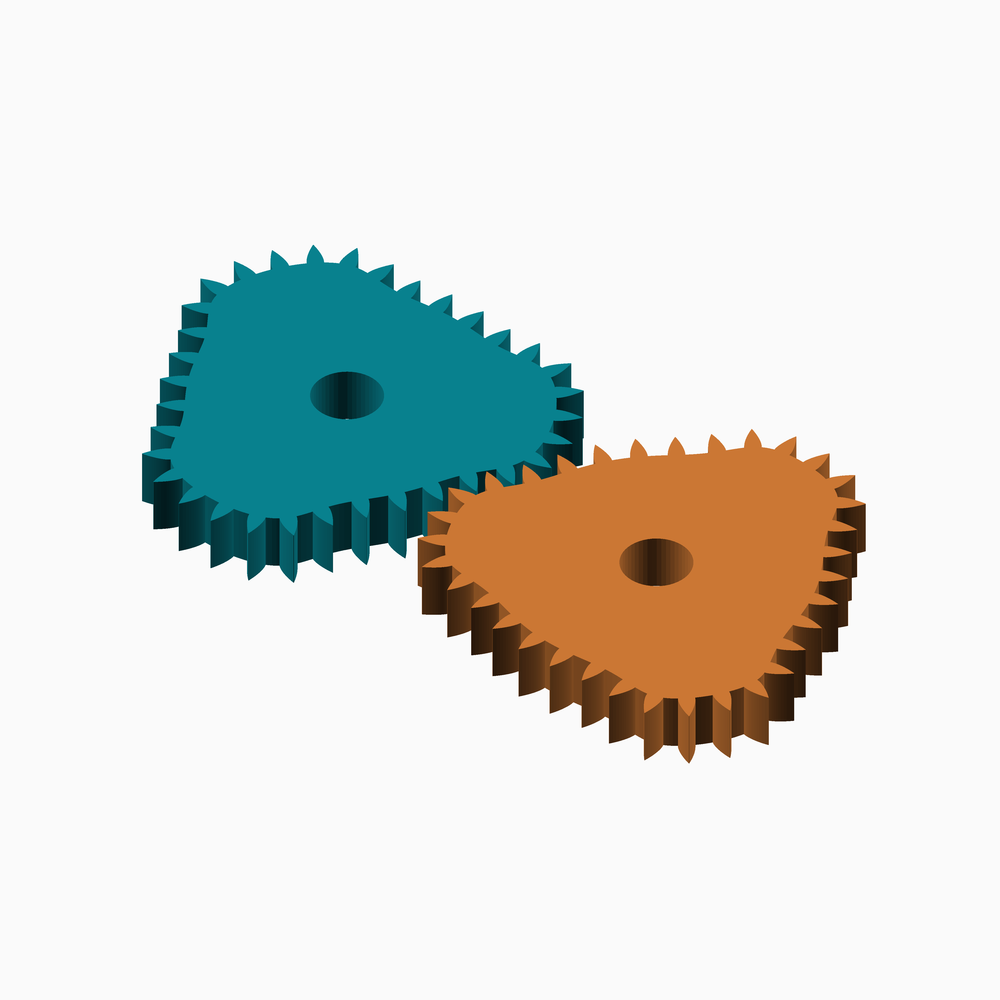](../images/functions/tanh_triad/curve_gear_tanh_triad_pair.png) | [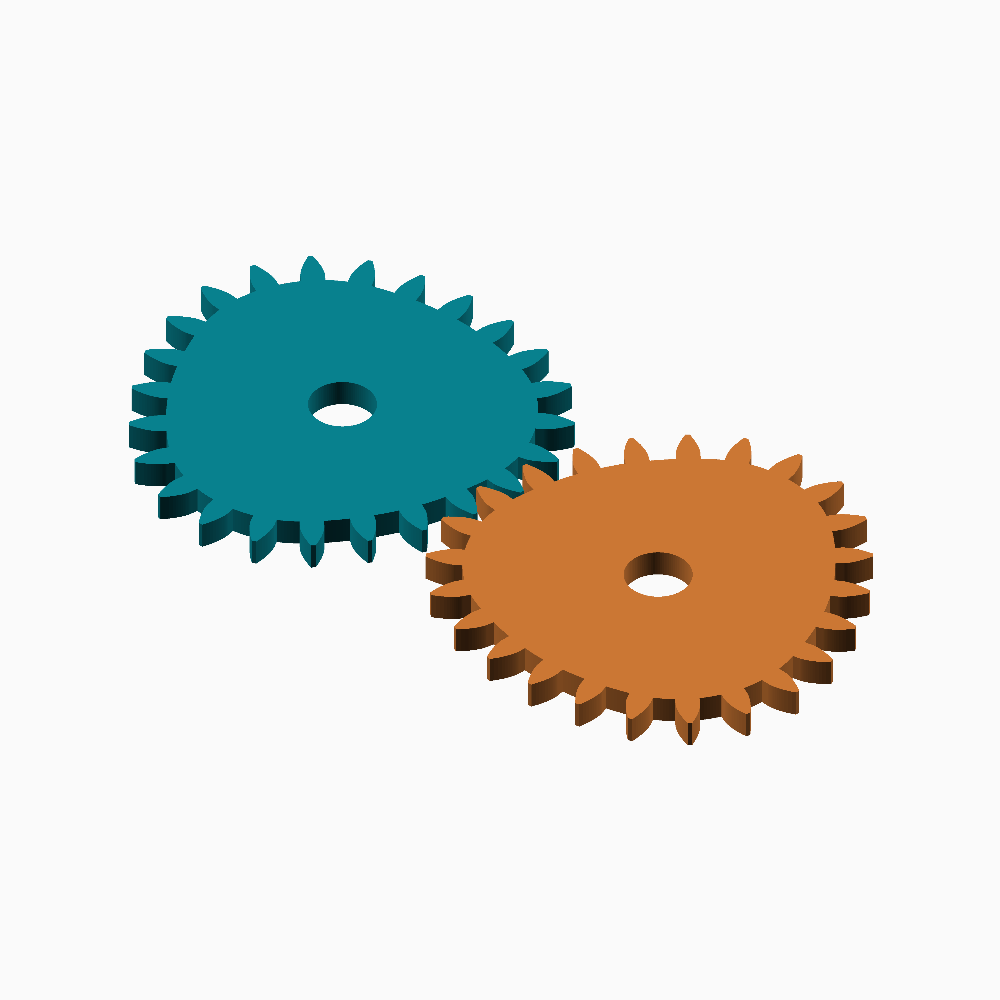](../images/functions/tanh_triad/curve_gear_tanh_triad_pair_alternative.png) |

**Parameters:**

- `modul`: {number, default .8} Tooth module.
- `tooth_number`: {integer, default 34} Tooth count.
- `width`: {number, default 4} Width.
- `bore`: {number, default 4.8} Bore.
- `transition`: {number, default 1.8} Transition.
- `crest`: {number, default .13} Crest.
- `correction`: {number, default .03} Correction.
- `pressure_angle`: {number, default 20} Pressure angle.
- `samples`: {integer, default 720} Samples.
- `phase`: {number, default 0} Pair phase.
- `together_built`: {boolean, default true} Mesh pair.
- `backlash`: {number, default undef} Backlash.
- `clearance`: {number, default undef} Clearance.
- `tooth_phase`: {number, default 0} Tooth phase.
- `driver_color`: {string, default "SteelBlue"} Driver colour.
- `mate_color`: {string, default "Gold"} Mate colour.

**Returns:**

No return

Back to [module description](#module-tanh-triad).

### Function `_cg_tanh_triad_parameters_valid`

Check the shared curve-parameter contract for every family entry point.

**Parameters:**

- `transition`: {number > 0} Curve parameter.
- `crest`: {number between 0 and 0.5} Curve parameter.
- `correction`: {number >= 0 and < 0.2} Curve parameter.

**Returns:**

- `{boolean}`: True when all curve parameters are supported.

Back to [module description](#module-tanh-triad).

### Function `_cg_tanh_triad_shape`

Bind the named curve once for driver, mate and numeric consumers.

**Parameters:**

- `modul`: {number > 0} Tooth module in mm.
- `tooth_number`: {integer >= 3} Number of teeth.
- `transition`: {number} Named curve control.
- `crest`: {number} Named curve control.
- `correction`: {number} Named curve control.
- `samples`: {integer, default 720} Curve and motion sampling count.

**Returns:**

- `{array}`: Shared polar shape descriptor; the family owns only its mathematical controls.

Back to [module description](#module-tanh-triad).

### Function `_cg_tanh_triad_unit_radius`

Evaluate the stable bounded Tanh Triad radius law.

**Parameters:**

No parameters

**Returns:**

No return

Back to [module description](#module-tanh-triad).

Back to [top](#).

---

[Back to the CurveGears README](../README.md)

*Generated by Doxydown from repository source comments; do not edit this page directly.*
